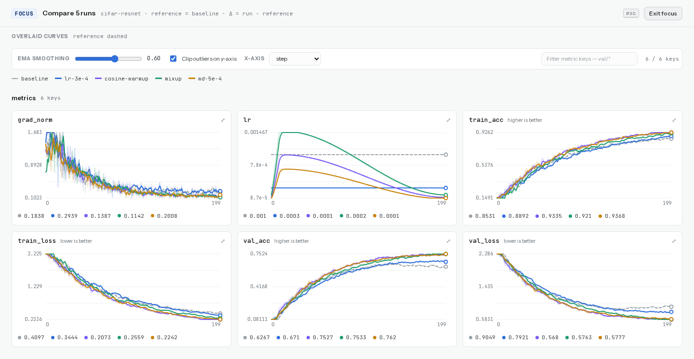

# agenticml-lite

Experiment tracking for machine learning that runs from files on disk. A W&B-style Python API, a local dashboard, and no server to run.

[](https://pypi.org/project/agenticml-lite/) [](https://pypi.org/project/agenticml-lite/) [](https://github.com/agenticML/agenticml-lite/blob/main/LICENSE) [](https://github.com/agenticML/agenticml-lite/actions/workflows/test.yml) [](https://agenticml.github.io/agenticml-lite/)



Training writes metrics, config, code and media to files on disk, and `agenticml ui` shows them in a local dashboard. When you want to share runs with a team, sync them to your own `agenticml server` or to the hosted service (public preview).

## Quickstart

```bash
pip install agenticml-lite
```

```python
import agenticml

agenticml.init(project="demo", name="exp1", config={"learning_rate": 0.01})

for step in range(10):
    agenticml.log({"loss": 1 / (step + 1)}, step=step)

agenticml.finish()
```

Or track an existing script without editing it:

```bash
agenticml run train.py
```

Then open the dashboard:

```bash
agenticml ui
```

Install the package as `agenticml-lite` and import it as `agenticml`. It needs Python 3.10 or newer.

## Features

- **Runs are files.** Metrics, config, code and media are written to plain files under `~/.agenticml`. Nothing leaves your machine unless you sync.
- **Zero-code tracking.** `agenticml run train.py` records a script's `argparse` or Hydra config, code and system information without an `import agenticml`.
- **Code snapshots and diffs.** Runtime code snapshots are stored with each run, and the dashboard and `agenticml lineage diff` show what changed between runs.
- **PyTorch component detection.** The model, optimizer, loss and dataloader are recorded automatically.
- **TensorBoard mirroring.** Scalars, images, figures and hparams written through `SummaryWriter` or `tensorboardX` are mirrored into the run under `agenticml run`, or with `init(sync_tensorboard=True)`.
- **System and GPU metrics.** CPU, memory and disk through `psutil`, and NVIDIA GPU metrics through `pynvml` (install the `system` and `gpu` extras).
- **Media and artifacts.** Log images and files, by reference or as a snapshot of the bytes. Images need the `media` extra.
- **Self-hosted server.** `agenticml server serve` gives a team a shared dashboard and sync endpoint, with workspaces, roles and an audit log. It is open source (MIT).
- **Hosted service (public preview).** The same server, run for you at [app.agenticml.xyz](https://app.agenticml.xyz).
- **Fast and small.** About 3 µs per `log()` call and about 8 bytes per scalar point on disk.

## How it compares

| | agenticml-lite | Weights & Biases | MLflow | TensorBoard | Aim | Trackio |
| --- | --- | --- | --- | --- | --- | --- |
| License | MIT (client and server) | Client MIT, server commercial | Apache-2.0 | Apache-2.0 | Apache-2.0 | MIT |
| Local dashboard, no account or server setup | Yes | No | Yes | Yes | Yes | Yes |
| Self-hosted team server | Yes, open source, with workspaces, roles and audit log | Commercial license | Yes | No | Yes | Yes |
| Hosted option | Yes (public preview) | Yes | Through managed providers | No | – | Hugging Face Spaces |
| Track a script without editing it | `agenticml run train.py` | – | – | – | – | – |

Checked November 2026. If something here is wrong or out of date, please open an issue.

## Share runs with a team

- Run your own server with `agenticml server serve`. See [Installation and deployment](https://agenticml.github.io/agenticml-lite/server/install/) and [Authentication and keys](https://agenticml.github.io/agenticml-lite/server/keys/). Inside a private network or lab VPC, see [Private networks](https://agenticml.github.io/agenticml-lite/server/private-network/). To deploy in your own AWS account with CloudFormation, see [Deploy on AWS](https://agenticml.github.io/agenticml-lite/server/deploy-on-aws/).
- On each training machine, run `agenticml login --host https://your-server` and then `agenticml sync --all`, or `agenticml sync --follow` to keep syncing. See [Syncing runs](https://agenticml.github.io/agenticml-lite/server/sync/).
- Or use the hosted service in public preview at app.agenticml.xyz. See the [hosted quickstart](https://agenticml.github.io/agenticml-lite/hosted/quickstart/).

## Documentation

Docs site: <https://agenticml.github.io/agenticml-lite/>

- Getting started: [Installation](https://agenticml.github.io/agenticml-lite/getting-started/installation/), [Quickstart](https://agenticml.github.io/agenticml-lite/getting-started/quickstart/)
- Guides: [Zero-code runs](https://agenticml.github.io/agenticml-lite/guides/zero-code/), [Python SDK](https://agenticml.github.io/agenticml-lite/guides/python-sdk/), [Dashboard](https://agenticml.github.io/agenticml-lite/guides/dashboard/), [Distributed, resume, disabled](https://agenticml.github.io/agenticml-lite/guides/distributed/)
- Reference: [Storage and disk](https://agenticml.github.io/agenticml-lite/reference/storage/), [Configuration](https://agenticml.github.io/agenticml-lite/reference/configuration/)
- Server: [Install](https://agenticml.github.io/agenticml-lite/server/install/), [Keys](https://agenticml.github.io/agenticml-lite/server/keys/), [Sync](https://agenticml.github.io/agenticml-lite/server/sync/), [Backups](https://agenticml.github.io/agenticml-lite/server/backups/), [Upgrade](https://agenticml.github.io/agenticml-lite/server/upgrade/), [Private networks](https://agenticml.github.io/agenticml-lite/server/private-network/), [Deploy on AWS](https://agenticml.github.io/agenticml-lite/server/deploy-on-aws/)
- [Hosted service](https://agenticml.github.io/agenticml-lite/hosted/) and [Releases](https://agenticml.github.io/agenticml-lite/releases/)
- In the repository: [docs/SDK.md](https://github.com/agenticML/agenticml-lite/blob/main/docs/SDK.md), [docs/FORMAT.md](https://github.com/agenticML/agenticml-lite/blob/main/docs/FORMAT.md), [docs/PROTOCOL.md](https://github.com/agenticML/agenticml-lite/blob/main/docs/PROTOCOL.md), [docs/SERVER.md](https://github.com/agenticML/agenticml-lite/blob/main/docs/SERVER.md), [docs/HOSTED.md](https://github.com/agenticML/agenticml-lite/blob/main/docs/HOSTED.md), [docs/THREAT_MODEL.md](https://github.com/agenticML/agenticml-lite/blob/main/docs/THREAT_MODEL.md)

## Contributing

See [CONTRIBUTING.md](https://github.com/agenticML/agenticml-lite/blob/main/CONTRIBUTING.md). If agenticml-lite is useful to you, a star on GitHub helps others find it.

## License

MIT — see [LICENSE](https://github.com/agenticML/agenticml-lite/blob/main/LICENSE).
